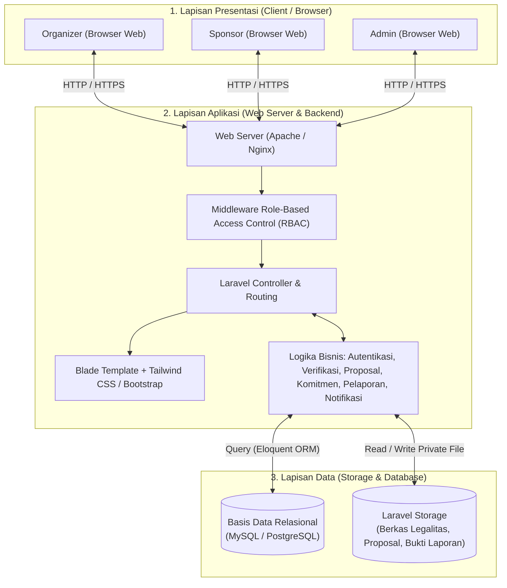
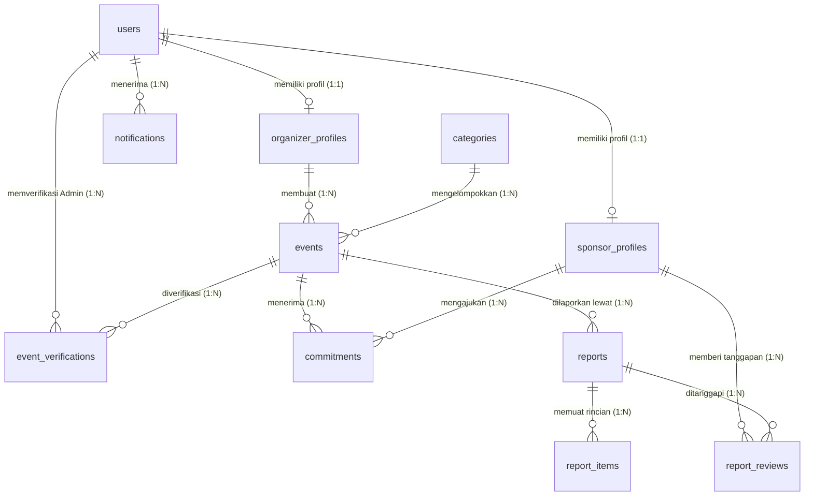
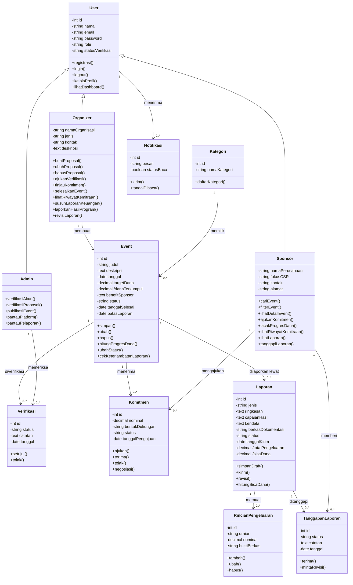

# System & UI/UX Design Document (DESIGN.md) — Sponsora

**Nama Proyek:** Sponsora  
**Tema:** SDG 17 — Kemitraan untuk Mencapai Tujuan (*Partnerships for the Goals*)  
**Mata Kuliah:** Proyek Perangkat Lunak (PPL) — Kelompok 6  
**Tech Stack Utama:** Laravel (PHP), Blade Template, Tailwind CSS / Bootstrap, MySQL / PostgreSQL  
**Resolusi Acuan Desain (Figma):** Desktop $1440\text{ px}$  

---

## 1. Arsitektur Sistem (Three-Tier Architecture)

Sponsora dirancang menggunakan arsitektur tiga lapisan (*Three-Tier Architecture*) untuk memisahkan tanggung jawab antara antarmuka pengguna, logika bisnis, dan pengelolaan data.

### 1.1 Diagram Arsitektur



### 1.2 Spesifikasi Tiap Lapisan
1. **Lapisan Presentasi (*Presentation Layer*):**
   * Berjalan pada peramban web pengguna (*Organizer*, *Sponsor*, *Admin*) menggunakan HTML5, CSS3, dan JavaScript.
   * Mengadopsi dua pola tata letak utama: **Public/Catalog Layout** (Landing Page, Katalog, Detail Event, Profil) dan **Workspace Sidebar Layout** (Dashboard Organizer & Pusat Verifikasi Admin).
2. **Lapisan Aplikasi (*Application Layer*):**
   * Ditenagai oleh **PHP Laravel** di atas web server **Apache/Nginx**.
   * **Middleware RBAC:** Memeriksa status autentikasi (`auth`), peran pengguna (`role:organizer|sponsor|admin`), dan status verifikasi akun (`status_verifikasi == 'Terverifikasi'`) sebelum mengizinkan transaksi inti.
3. **Lapisan Data (*Data Layer*):**
   * **MySQL / PostgreSQL:** Menyimpan 11 tabel relasional dengan integritas *foreign key*.
   * **Laravel Storage:** Menyimpan dokumen legalitas (SK Organisasi / NIB Perusahaan), dokumen proposal event, berkas bukti nota pengeluaran, dan dokumentasi hasil program dengan validasi format (`PDF`, `JPG`, `PNG`) dan ukuran maksimum $\le 5\text{ MB}$.

---

## 2. Rancangan Basis Data (ERD & Spesifikasi Skema)

Basis data Sponsora terdiri dari **11 entitas utama**. Skema di bawah ini menggabungkan entitas pada Bab 4.3 Proposal dengan atribut formulir tambahan yang terdapat pada *mockup* Figma terbaru.

### 2.1 Diagram Relasi Entitas (ERD)



### 2.2 Kamus Data & Struktur Tabel (11 Tabel)

#### 1. Tabel `users`
Menyimpan kredensial utama dan status verifikasi seluruh akun pengguna.
| Nama Kolom | Tipe Data | Constraint | Keterangan |
| :--- | :--- | :--- | :--- |
| `id` | `BIGINT UNSIGNED` | `PK, AUTO_INCREMENT` | Primary Key pengguna |
| `name` | `VARCHAR(255)` | `NOT NULL` | Nama lengkap / Nama penanggung jawab |
| `email` | `VARCHAR(255)` | `UNIQUE, NOT NULL` | Alamat surel login |
| `password` | `VARCHAR(255)` | `NOT NULL` | Kata sandi ter-hash (`bcrypt`) |
| `role` | `ENUM` | `NOT NULL` | Nilai: `'organizer'`, `'sponsor'`, `'admin'` |
| `status_verifikasi` | `ENUM` | `DEFAULT 'Menunggu Verifikasi'` | Nilai: `'Menunggu Verifikasi'`, `'Terverifikasi'`, `'Ditolak'` |
| `remember_token` | `VARCHAR(100)` | `NULLABLE` | Token fitur "Ingat saya" pada halaman login |
| `created_at` | `TIMESTAMP` | `NULLABLE` | Waktu registrasi akun |
| `updated_at` | `TIMESTAMP` | `NULLABLE` | Waktu pembaruan terakhir |

#### 2. Tabel `organizer_profiles`
Menyimpan identitas organisasi penyelenggara (HIMA/UKM/NGO/NPO/Komunitas).
| Nama Kolom | Tipe Data | Constraint | Keterangan |
| :--- | :--- | :--- | :--- |
| `id` | `BIGINT UNSIGNED` | `PK, AUTO_INCREMENT` | Primary Key profil organizer |
| `user_id` | `BIGINT UNSIGNED` | `FK (users.id), UNIQUE` | Relasi $1:1$ ke tabel `users` |
| `nama_organisasi` | `VARCHAR(255)` | `NOT NULL` | Contoh: *Komunitas Aksi Muda* |
| `jenis` | `ENUM` | `NOT NULL` | Nilai: `'HIMA'`, `'UKM'`, `'NGO'`, `'NPO'`, `'Komunitas'` |
| `nama_penanggung_jawab`| `VARCHAR(255)` | `NOT NULL` | Nama PIC dari form Registrasi Organizer |
| `kontak` | `VARCHAR(50)` | `NOT NULL` | Nomor telepon / WhatsApp aktif |
| `alamat` | `TEXT` | `NULLABLE` | Alamat organisasi (sesuai form registrasi UI) |
| `deskripsi` | `TEXT` | `NULLABLE` | Deskripsi singkat organisasi |
| `dokumen_legalitas` | `VARCHAR(255)` | `NOT NULL` | Path berkas SK Komunitas / Organisasi (`.pdf`/`.jpg`/`.png`) |

#### 3. Tabel `sponsor_profiles`
Menyimpan identitas perusahaan pemilik program CSR.
| Nama Kolom | Tipe Data | Constraint | Keterangan |
| :--- | :--- | :--- | :--- |
| `id` | `BIGINT UNSIGNED` | `PK, AUTO_INCREMENT` | Primary Key profil sponsor |
| `user_id` | `BIGINT UNSIGNED` | `FK (users.id), UNIQUE` | Relasi $1:1$ ke tabel `users` |
| `nama_perusahaan` | `VARCHAR(255)` | `NOT NULL` | Contoh: *PT Maju Bersama* / *PT Nusa Karya* |
| `nib_perusahaan` | `VARCHAR(100)` | `NOT NULL` | Nomor Induk Berusaha (sesuai form registrasi UI) |
| `nama_penanggung_jawab`| `VARCHAR(255)` | `NOT NULL` | Nama PIC CSR perusahaan |
| `fokus_csr` | `VARCHAR(255)` | `NOT NULL` | Contoh: *Lingkungan, Pendidikan* |
| `kontak` | `VARCHAR(50)` | `NOT NULL` | Nomor telepon perusahaan |
| `alamat` | `TEXT` | `NULLABLE` | Alamat / Tentang perusahaan |
| `dokumen_legalitas` | `VARCHAR(255)` | `NOT NULL` | Path berkas NIB / Legalitas Perusahaan (`.pdf`/`.jpg`/`.png`) |

#### 4. Tabel `categories`
Menyimpan master kategori kegiatan untuk filter katalog.
| Nama Kolom | Tipe Data | Constraint | Keterangan |
| :--- | :--- | :--- | :--- |
| `id` | `BIGINT UNSIGNED` | `PK, AUTO_INCREMENT` | Primary Key kategori |
| `nama_kategori` | `VARCHAR(100)` | `UNIQUE, NOT NULL` | Contoh: *Pendidikan*, *Lingkungan*, *Kesehatan*, *Sosial* |

#### 5. Tabel `events`
Menyimpan data proposal kegiatan beserta status dan batas waktu pelaporannya.
| Nama Kolom | Tipe Data | Constraint | Keterangan |
| :--- | :--- | :--- | :--- |
| `id` | `BIGINT UNSIGNED` | `PK, AUTO_INCREMENT` | Primary Key event |
| `organizer_id` | `BIGINT UNSIGNED` | `FK (organizer_profiles.id)` | Pemilik kegiatan |
| `category_id` | `BIGINT UNSIGNED` | `FK (categories.id)` | Kategori kegiatan |
| `judul` | `VARCHAR(255)` | `NOT NULL` | Judul event (contoh: *Gerakan Pesisir Bersih 2026*) |
| `deskripsi` | `TEXT` | `NOT NULL` | Ringkasan dan detail tentang kegiatan |
| `lokasi` | `VARCHAR(255)` | `NULLABLE` | Lokasi pelaksanaan (contoh: *Pesisir Jawa Timur*) |
| `penerima_manfaat` | `VARCHAR(150)` | `NULLABLE` | Target dampak (contoh: *1.200+ warga*) |
| `tanggal_pelaksanaan`| `DATE` | `NOT NULL` | Tanggal acara berlangsung |
| `target_dana` | `DECIMAL(15,2)` | `NOT NULL` | Total kebutuhan dana sponsorship |
| `benefit_sponsor` | `TEXT` | `NOT NULL` | Daftar kontraprestasi / benefit bagi sponsor |
| `poster_berkas` | `VARCHAR(255)` | `NULLABLE` | Path gambar sampul/banner katalog event |
| `proposal_berkas` | `VARCHAR(255)` | `NULLABLE` | Path berkas PDF proposal lengkap (Langkah 4 Buat Proposal) |
| `status` | `ENUM` | `DEFAULT 'Draft'` | `'Draft'`, `'Menunggu Verifikasi'`, `'Perlu Revisi'`, `'Terverifikasi'`, `'Selesai'`, `'Dilaporkan'` |
| `tanggal_selesai` | `DATE` | `NULLABLE` | Tanggal saat event ditandai selesai |
| `batas_laporan` | `DATE` | `NULLABLE` | Tenggat waktu pengiriman laporan pertanggungjawaban |

#### 6. Tabel `event_verifications`
Mencatat riwayat moderasi dan catatan revisi Admin atas proposal event.
| Nama Kolom | Tipe Data | Constraint | Keterangan |
| :--- | :--- | :--- | :--- |
| `id` | `BIGINT UNSIGNED` | `PK, AUTO_INCREMENT` | Primary Key log verifikasi |
| `event_id` | `BIGINT UNSIGNED` | `FK (events.id)` | Event yang ditinjau |
| `admin_id` | `BIGINT UNSIGNED` | `FK (users.id)` | Admin peninjau |
| `status` | `ENUM` | `NOT NULL` | `'Disetujui'` (`Terverifikasi`), `'Ditolak'` (`Perlu Revisi`) |
| `catatan` | `TEXT` | `NULLABLE` | Catatan perbaikan wajib jika ditolak |
| `tanggal_verifikasi` | `TIMESTAMP` | `NOT NULL` | Waktu keputusan verifikasi |

#### 7. Tabel `commitments`
Menyimpan pengajuan komitmen pendanaan/dukungan dari Sponsor ke suatu Event.
| Nama Kolom | Tipe Data | Constraint | Keterangan |
| :--- | :--- | :--- | :--- |
| `id` | `BIGINT UNSIGNED` | `PK, AUTO_INCREMENT` | Primary Key komitmen |
| `event_id` | `BIGINT UNSIGNED` | `FK (events.id)` | Event tujuan pendanaan |
| `sponsor_id` | `BIGINT UNSIGNED` | `FK (sponsor_profiles.id)` | Sponsor pemberi komitmen |
| `nominal` | `DECIMAL(15,2)` | `NOT NULL` | Nilai nominal komitmen dukungan |
| `bentuk_dukungan` | `VARCHAR(255)` | `NOT NULL` | Contoh: *Dana Tunai / Fasilitas Pemilahan Sampah* |
| `catatan` | `TEXT` | `NULLABLE` | Catatan tambahan dari Sponsor / catatan negosiasi Organizer |
| `status` | `ENUM` | `DEFAULT 'Menunggu Tanggapan'`| `'Menunggu Tanggapan'`, `'Diterima'`, `'Ditolak'`, `'Negosiasi'` |
| `tanggal_pengajuan` | `TIMESTAMP` | `NOT NULL` | Waktu komitmen dikirim |

#### 8. Tabel `notifications`
Menyimpan pemberitahuan perubahan status lintas peran.
| Nama Kolom | Tipe Data | Constraint | Keterangan |
| :--- | :--- | :--- | :--- |
| `id` | `BIGINT UNSIGNED` | `PK, AUTO_INCREMENT` | Primary Key notifikasi |
| `user_id` | `BIGINT UNSIGNED` | `FK (users.id)` | Penerima notifikasi |
| `pesan` | `TEXT` | `NOT NULL` | Isi pesan pemberitahuan |
| `status_baca` | `BOOLEAN` | `DEFAULT FALSE` | `0` = Belum dibaca, `1` = Sudah dibaca |
| `created_at` | `TIMESTAMP` | `NOT NULL` | Waktu notifikasi dikirim |

#### 9. Tabel `reports`
Menyimpan Laporan Keuangan dan Laporan Hasil Program pasca-kegiatan.
| Nama Kolom | Tipe Data | Constraint | Keterangan |
| :--- | :--- | :--- | :--- |
| `id` | `BIGINT UNSIGNED` | `PK, AUTO_INCREMENT` | Primary Key laporan |
| `event_id` | `BIGINT UNSIGNED` | `FK (events.id)` | Event yang dilaporkan |
| `jenis` | `ENUM` | `NOT NULL` | Nilai: `'keuangan'`, `'hasil_program'` |
| `ringkasan` | `TEXT` | `NULLABLE` | Ringkasan pelaksanaan / rekonsiliasi |
| `capaian_hasil` | `TEXT` | `NULLABLE` | Indikator & realisasi capaian program |
| `kendala` | `TEXT` | `NULLABLE` | Evaluasi dan kendala pelaksanaan |
| `berkas_dokumentasi`| `VARCHAR(255)` | `NULLABLE` | Path bundel bukti / foto dokumentasi (`.pdf`/`.jpg`/`.png`) |
| `status` | `ENUM` | `DEFAULT 'Draft'` | `'Draft'`, `'Dikirim'`, `'Perlu Revisi'`, `'Diterima'` |
| `tanggal_kirim` | `TIMESTAMP` | `NULLABLE` | Waktu laporan dikirim ke Sponsor |

#### 10. Tabel `report_items`
Menyimpan baris rincian pengeluaran aktual pada Laporan Keuangan.
| Nama Kolom | Tipe Data | Constraint | Keterangan |
| :--- | :--- | :--- | :--- |
| `id` | `BIGINT UNSIGNED` | `PK, AUTO_INCREMENT` | Primary Key item pengeluaran |
| `report_id` | `BIGINT UNSIGNED` | `FK (reports.id)` | Relasi ke Laporan Keuangan |
| `uraian` | `VARCHAR(255)` | `NOT NULL` | Pos / rincian pengeluaran |
| `nominal` | `DECIMAL(15,2)` | `NOT NULL` | Biaya aktual yang dikeluarkan |
| `bukti_berkas` | `VARCHAR(255)` | `NOT NULL` | Path nota/kwitansi bukti pengeluaran |

#### 11. Tabel `report_reviews`
Menyimpan keputusan tanggapan setiap Sponsor terhadap laporan suatu Event.
| Nama Kolom | Tipe Data | Constraint | Keterangan |
| :--- | :--- | :--- | :--- |
| `id` | `BIGINT UNSIGNED` | `PK, AUTO_INCREMENT` | Primary Key review laporan |
| `report_id` | `BIGINT UNSIGNED` | `FK (reports.id)` | Laporan yang ditanggapi |
| `sponsor_id` | `BIGINT UNSIGNED` | `FK (sponsor_profiles.id)` | Sponsor peninjau |
| `status` | `ENUM` | `NOT NULL` | `'Diterima'`, `'Perlu Revisi'` |
| `catatan` | `TEXT` | `NULLABLE` | Catatan revisi wajib apabila meminta perbaikan |
| `tanggal_tanggapan` | `TIMESTAMP` | `NOT NULL` | Waktu tanggapan disimpan |

---

## 3. Rancangan Class Diagram (Object-Oriented Design)

Diagram kelas berikut merepresentasikan struktur model dan logika bisnis pada backend Laravel sesuai Bab 4.4 Proposal. Atribut dengan awalan `/` menandakan *derived attribute* (dihitung otomatis melalui *accessor*/query agregasi, bukan kolom statis).



---

## 4. Sistem Desain Visual (UI/UX Design Tokens)

Seluruh kode warna, tipografi, bayangan (*elevation*), dan *border-radius* di bawah ini diekstrak secara presisi dari spesifikasi CSS Figma proyek Sponsora.

### 4.1 Palet Warna (Color Palette)

#### A. Warna Utama & Aksen (Brand Colors)
| Nama Token | Kode Hex | Penggunaan Utama |
| :--- | :--- | :--- |
| **Brand Primary Dark** | `#173F30` | Warna utama tombol CTA, latar *Hero Dark*, panel kiri Login/Register, teks judul utama, dan batang aktif grafik. |
| **Brand Secondary Forest**| `#2F6B52` | Warna aksen pada ruang kerja (*Workspace*), ikon aktif, kotak centang (*checkbox*), dan tombol utama modul pelaporan. |
| **Brand Deep Green** | `#234F3D` | Teks identitas logo `SPONSORA` dan teks pesan informasi di dalam kotak *alert*. |
| **Accent Lime Primary** | `#BCD63E` | Bilah progres pendanaan (*progress bar*), ikon lingkaran sukses, dan sorotan metrik. |
| **Accent Lime Soft** | `#D9ED70` | Subjudul di atas latar gelap (`#173F30`) dan tombol *toggle* aktif ("Untuk Sponsor" / "Untuk Organizer"). |
| **Accent Banner Lime** | `#CFE45A` | Latar belakang *banner* CTA bawah pada Landing Page ("Dampak besar selalu dimulai dari satu koneksi"). |
| **Olive Label Green** | `#5D791C` | Subjudul seksi publik (contoh: `PILIHAN UNTUKMU`, `PENGATURAN AKUN`, `PENDANAAN EVENT`). |

#### B. Warna Latar & Permukaan (Background & Surface)
| Nama Token | Kode Hex | Penggunaan Utama |
| :--- | :--- | :--- |
| **Bg Public Warm** | `#FBFCF8` | Latar belakang utama halaman publik, Katalog, Detail Event, Profil, dan panel kanan Login/Register. |
| **Bg Public Navbar** | `#F6F7F2` | Latar belakang bilah navigasi atas (*navbar*) publik, Sponsor, dan Organizer. |
| **Bg Workspace Gray** | `#F7F9F8` | Latar belakang kanvas ruang kerja (*Dashboard Organizer* & *Pusat Verifikasi Admin*) serta header tabel. |
| **Surface Pure White** | `#FFFFFF` | Latar belakang kartu event, kartu metrik, sidebar navigasi, tabel, dan modal *popup*. |
| **Surface Mint Tint** | `#EAF2EE` | Latar belakang item navigasi aktif di sidebar, kotak informasi (*alert box*), dan *highlight* baris pertama tabel. |
| **Surface Sage Tint** | `#EEF4D9` | Latar belakang seksi cerita CSR dan tombol sosial media di footer. |

#### C. Warna Teks, Garis Batas, & Semantik (Text, Border, & Status)
| Kategori | Kode Hex | Penggunaan Utama |
| :--- | :--- | :--- |
| **Text Heading Dark** | `#1F2933` | Judul halaman *workspace* (`28px`), subjudul kartu (`16px`), dan label input (`12px`). |
| **Text Body Charcoal** | `#333333` | Teks paragraf deskripsi (sering dipadukan dengan `opacity: 0.8`). |
| **Text Muted Gray** | `#6B7280` | Teks keterangan tambahan, *subtitle* halaman, teks *placeholder*, dan menu sidebar non-aktif. |
| **Border Workspace** | `#E5E7EB` | Garis batas kartu *workspace*, input form (`1px solid`), pemisah sidebar, dan garis baris tabel. |
| **Border Public Card** | `#D4DBD8` | Garis batas kartu publik, kotak pencarian katalog (`2px solid`), dan kartu ringkasan Detail Event. |
| **Badge Approved (Hijau)**| Latar `#E7F3DE` / `#E5F4EE`<br>Teks `#4F703B` / `#176B4A` | Lencana status `Disetujui`, `Terverifikasi`, `Sponsor Terverifikasi`, dan `Organizer Terverifikasi`. |
| **Badge Pending (Kuning/Amber)**| Latar `#FFF0DF` / `#F4C542`<br>Teks `#A16118` / `#1F2933` | Lencana status `Ditinjau`, `Menunggu Verifikasi`, `Perlu Revisi`, dan `Perlu Perhatian`. |
| **Semantic Danger (Merah)**| `#A0493F` | Teks dan ikon menu `Keluar` (*Logout*) pada *popup* profil. |

---

### 4.2 Sistem Tipografi (Typography Scale)

Sponsora menggunakan kombinasi dua keluarga fon utama dari Google Fonts:
1. **`Poppins`**: Digunakan untuk seluruh halaman publik (Landing Page, Katalog, Detail Event, Edit Profil) serta judul sambutan utama.
2. **`Inter`**: Digunakan untuk komponen fungsional padat data seperti formulir Registrasi/Login, Sidebar, Tabel, Lencana Status (*Badges*), dan seluruh layar *Workspace Dashboard*.
3. **`Lato`** *(Opsional/Pendukung)*: Digunakan pada teks kartu *hero* miring di Landing Page.

| Token Tipografi | Font Family | Ukuran (`font-size`) | Ketebalan (`font-weight`) | Line Height | Penggunaan |
| :--- | :--- | :--- | :--- | :--- | :--- |
| **Display Hero XL** | `Poppins` | $56\text{ px}$ | `700 (Bold)` | $124.5\%$ ($70\text{ px}$) | Judul utama Hero ("Satu Ruang Untuk Dampak Nyata") |
| **Section Heading LG**| `Poppins` | $50\text{ px}$ | `700 (Bold)` | $124.5\%$ ($62\text{ px}$) | Judul seksi Landing Page & Panel Kiri Login/Register |
| **Event TitleDetail** | `Poppins` | $38\text{ px}$ | `600 (SemiBold)`| $140\%$ ($53\text{ px}$) | Judul utama pada halaman Detail Event |
| **Page Title (Auth)** | `Poppins` | $32\text{ px}$ | `700 (Bold)` | $124.5\%$ ($40\text{ px}$) | "Mulai Bersama Sponsora", "Selamat Datang Kembali" |
| **Workspace Title** | `Poppins` / `Inter`| $28\text{ px}$ | `600 (SemiBold)`| $145\%$ ($41\text{ px}$) | Judul halaman Dashboard & angka indikator KPI utama |
| **Card Title** | `Poppins` | $24\text{ px}$ | `600 (SemiBold)`| $140\%$ ($34\text{ px}$) | Judul event pada kartu katalog & nominal utama |
| **Workspace Subtitle**| `Inter` | $16\text{ px}$ | `600 (SemiBold)`| $145\%$ ($23\text{ px}$) | Judul panel/kartu di dalam Dashboard |
| **Body Regular** | `Poppins` | $16\text{ px}$ | `400 / 500` | $150\% - 169\%$ | Paragraf deskripsi publik & tautan *Navbar* |
| **Button Label** | `Inter` / `Poppins`| $13\text{ px} - 15\text{ px}$| `600 (SemiBold)`| $16\text{ px} - 24\text{ px}$| Teks di dalam tombol aksi utama dan sekunder |
| **Form Input & Body SM**| `Inter` | $13\text{ px}$ | `400 (Regular)` | $145\%$ ($19\text{ px}$) | Teks isian input form dan subjudul pengantar dashboard |
| **Form Label & Table**| `Inter` | $12\text{ px}$ | `600 (SemiBold)`| $145\%$ ($17\text{ px}$) | Label di atas input form, item navigasi, dan isi tabel |
| **Badge & Helper XS** | `Inter` | $11\text{ px}$ | `400 / 600` | $135\% - 145\%$ | Teks lencana status (*badge*) dan keterangan bawah input |

---

### 4.3 Konfigurasi Tailwind CSS Siap Pakai

Pengembang dapat langsung menyalin konfigurasi berikut ke dalam berkas `tailwind.config.js` pada proyek Laravel agar seluruh kelas warna dan fon sesuai dengan desain Figma:

```javascript
// tailwind.config.js
export default {
  content: [
    "./resources/**/*.blade.php",
    "./resources/**/*.js",
  ],
  theme: {
    extend: {
      fontFamily: {
        poppins: ['Poppins', 'sans-serif'],
        inter: ['Inter', 'sans-serif'],
        lato: ['Lato', 'sans-serif'],
      },
      colors: {
        sponsora: {
          dark: '#173F30',        // Primary Brand Dark Green
          forest: '#2F6B52',      // Workspace Primary Green
          deep: '#234F3D',        // Logo & Info Text Green
          lime: '#BCD63E',        // Progress Bar & Highlight Lime
          'lime-soft': '#D9ED70', // Dark Section Accent Text/Button
          'lime-banner': '#CFE45A', // CTA Banner Background
          olive: '#5D791C',       // Section Eyebrow Text
          'bg-warm': '#FBFCF8',   // Public Page Background
          'bg-nav': '#F6F7F2',    // Public Navbar Background
          'bg-work': '#F7F9F8',   // Workspace Canvas Background
          mint: '#EAF2EE',        // Active Sidebar & Alert Box
          sage: '#EEF4D9',        // Feature Banner Background
          border: '#E5E7EB',      // Workspace Border
          'border-pub': '#D4DBD8',// Public Card Border
          warning: '#F4C542',     // Pending Badge Background
          danger: '#A0493F',      // Logout / Reject Color
        }
      },
      borderRadius: {
        'card-lg': '40px',
        'feature': '45px',
        'modal': '60px',
      },
      boxShadow: {
        'card-pub': '0px 2px 4px rgba(40, 41, 61, 0.04), 0px 8px 16px rgba(96, 97, 112, 0.16)',
        'card-work': '0px 4px 16px rgba(35, 79, 61, 0.031)',
        'sticky-box': '0px 2px 4px rgba(0, 0, 0, 0.04), 0px 18px 45px rgba(21, 56, 45, 0.09)',
      }
    },
  },
  plugins: [],
}
```

---

## 5. Spesifikasi Tata Letak & Komponen UI (Component Library)

### 5.1 Pola Tata Letak Utama (Layouts)

1. **Tata Letak Publik & Katalog (`layouts/public.blade.php`):**
   * **Lebar Kanvas:** $1440\text{ px}$ dengan latar `#FBFCF8`.
   * **Top Navbar:** Tinggi $127\text{ px}$, latar `#F6F7F2`, `drop-shadow(0px 4px 5px rgba(0,0,0,0.1))`. Berisi Logo ($95\times 95\text{ px}$), 5 menu tengah (`Beranda`, `Jelajahi Event`, `Cara Kerja`, `Fitur`, `Tentang Kami` dengan `gap: 39px`), serta area aksi kanan:
     * *Sebelum Login:* Tautan `Masuk` + Tombol kapsul `Daftar Sekarang` ($174\times 45\text{ px}$, latar `#173F30`, `border-radius: 30px`).
     * *Setelah Login:* Tombol Lonceng Notifikasi bulat ($45\times 45\text{ px}$, latar `#FFFFFF`, border `#EBEFEC`) + Kapsul Profil Pengguna ($142\times 45\text{ px}$, avatar inisial bulat $35\times 35\text{ px}$ berlatar `#EAF2CE` + teks peran `Sponsor` atau `Organiz`).
   * **Popup Dropdown Profil:** Ukuran $216\times 179\text{ px}$ (Organizer) atau $216\times 148\text{ px}$ (Sponsor), latar `#FFFFFF`, `border: 1px solid rgba(79, 100, 91, 0.2)`, `border-radius: 20px`. Memuat menu: `Edit Profil`, `Lihat Dashboard`, `Upload Proposal` (khusus Organizer), garis pemisah, dan `Keluar` (`#A0493F`).

2. **Tata Letak Split-Screen Autentikasi (`layouts/auth.blade.php`):**
   * **Panel Kiri (Branding):** Lebar tetap $640\text{ px}$, tinggi penuh ($\ge 1024\text{ px}$), latar `#173F30`. Menampilkan logo di sudut kiri atas ($80\times 80\text{ px}$), teks "Cara kerja Sponsora" (`#D9ED70`), *heading* "Kolaborasi lebih dekat, proses lebih sederhana" (`50px Bold #FFFFFF`), deskripsi (`#9AB6B0`), dan 3 *glassmorphism pills* (`Terverifikasi`, `Transparan`, `Terukur` dengan latar `rgba(255,255,255,0.1)`, `border-radius: 12px`).
   * **Panel Kanan (Formulir):** Lebar $800\text{ px}$, latar `#FBFCF8`. Kontainer formulir berada di `left: 741px` dengan lebar bersih **$615\text{ px}$**.
   * **Role Switcher Tab (`Sponsor` | `Organizer`):** Kontainer luar $615\times 69\text{ px}$ berlatar `#E9EDE5` (`border-radius: 15px`), dengan tombol tab aktif berukuran $287\times 59\text{ px}$ berlatar `#FFFFFF` (`border-radius: 15px`).

3. **Tata Letak Ruang Kerja / Workspace (`layouts/workspace.blade.php`):**
   * Digunakan untuk seluruh halaman internal **Organizer** dan **Admin**.
   * **Sidebar Kiri Tetap:** Lebar **$232\text{ px}$**, tinggi penuh, latar `#FFFFFF`, `border-right: 1px solid #E5E7EB`, `padding: 32px 16px`, `gap: 32px`.
     * *Identitas:* Logo + teks `SPONSORA` (`20px Bold #234F3D`).
     * *Kotak Konteks Akun:* Ukuran $200\times 90\text{ px}$, latar `#EAF2EE`, `border-radius: 12px` (menampilkan label peran, nama organisasi, dan status verifikasi).
     * *Daftar Menu Utama:* Lebar item $200\times 42\text{ px}$, `padding: 12px`, `border-radius: 8px`. Item aktif memiliki latar `#EAF2EE` dan teks `12px SemiBold #173F30` (atau `#2F6B52`); item non-aktif berlatar `#FFFFFF` dengan teks `#6B7280`.
     * *Kartu Bantuan & Tombol Keluar:* Di bagian bawah sidebar ($200\times 154\text{ px}$, latar `#F7F9F8`).
   * **Area Kerja Kanan:** Lebar **$1208\text{ px}$**, latar `#F7F9F8`.
     * *Topbar:* Tinggi **$80\text{ px}$**, latar `#FFFFFF`, `border-bottom: 1px solid #E5E7EB`, `padding: 0 32px`. Menampilkan *breadcrumb*/konteks di kiri dan ikon lonceng + avatar di kanan.
     * *Konten Halaman:* `padding: 32px`, `gap: 24px`, menghasilkan lebar bersih konten **$1144\text{ px}$**.

---

### 5.2 Spesifikasi Komponen Standar

* **Input Formulir (`Bidang Isian`):**
  * Label: `Inter 12px SemiBold #1F2933`, jarak ke input `8px`.
  * Kotak Input: Tinggi `$44\text{ px}$`, `padding: 12px`, latar `#FFFFFF`, `border: 1px solid #E5E7EB`, `border-radius: 8px`, teks `Inter 13px Regular #1F2933`.
  * Area Unggah Berkas (*Dropzone*): Lebar penuh, tinggi `$69\text{ px}$`, `padding: 16px`, latar `#F7F9F8`, `border: 1px dashed #E5E7EB`, `border-radius: 8px`, ikon `upload-cloud` (`#2F6B52`), keterangan format (`PDF, JPG, PNG · Maksimal 5 MB per berkas`).
* **Tombol (*Buttons*):**
  * *Primary Workspace Button:* Tinggi `$44\text{ px}$`, `padding: 12px 16px`, latar `#173F30` (atau `#2F6B52`), `border-radius: 8px`, teks `Inter 13px SemiBold #FFFFFF`.
  * *Secondary Workspace Button:* Tinggi `$44\text{ px}$`, `padding: 12px 16px`, latar `#FFFFFF`, `border: 1px solid #E5E7EB`, `border-radius: 8px`, teks `Inter 13px SemiBold #173F30`.
  * *Public Pill CTA Button:* Tinggi `$45\text{ px} - 51\text{ px}$`, latar `#173F30`, `border-radius: 30px`, teks `Poppins 15px Medium #FFFFFF`.
* **Kartu Katalog Event (`Group 368/369/370`):**
  * Dimensi: **$416\times 458\text{ px}$** (3 kolom dalam grid $1269\text{ px}$), latar `#FFFFFF`, `border-radius: 16px`, bayangan `card-pub`.
  * Gambar Sampul: $391.42\times 287.25\text{ px}$, `border-radius: 8px`, dilengkapi lencana kategori di sudut kiri atas ($68\times 19\text{ px}$, `border-radius: 30px`).
  * Konten Bawah: Ikon centang `#BCD63E` + Nama Organizer (`12px SemiBold`), Judul Event (`24px SemiBold`), teks `Terkumpul: Rp X dari Rp Y`, bilah progres (`tinggi 6.95px`, latar `#D9D9D9`, isi `#BCD63E`), indikator sisa hari di kiri bawah, dan tautan `Lihat Detail ->` di kanan bawah.

---

## 6. Spesifikasi Rancangan Layar demi Layar (Screen-by-Screen)

### 6.1 Halaman Publik & Autentikasi
1. **Landing Page (`Landing Page Before/After Login`):**
   * **Hero Section:** Judul `56px Bold`, garis bawah hijau muda (`437x8px #E5F3A2`), tombol `Temukan Event ->` & `Ajukan proposal`, serta kartu *showcase* miring ($3.19^\circ$) di sisi kanan dengan *floating card* "Komitmen Baru + Rp 5.000.000".
   * **Stats Bar:** Lebar penuh $1440\times 120\text{ px}$ berlatar `#FFFFFF` menampilkan 4 metrik: `120+ Kegiatan Terverifikasi`, `48 Mitra Perusahaan`, `Rp 1,2 M Komitmen Tercatat`, dan `17 Kategori Dampak`.
   * **Seksi Katalog Pratinjau ("Aksi baik yang menanti dukungan"):** Dilengkapi bilah pencarian ($1269\times 47\text{ px}$) + tombol `Filter Kategori` dan 3 kartu event.
   * **Seksi "Cara kerja Sponsora":** Latar hijau gelap `#173F30` tinggi $635\text{ px}$ dengan *toggle switch* `Untuk Sponsor` / `Untuk Organizer` dan 3 langkah bernomor (`01`, `02`, `03`) dalam lingkaran berbingkai `#D9ED70`.
   * **Seksi Keunggulan ("Dirancang untuk Kemitraan yang tepercaya"):** Grid $2\times 2$ kartu besar ($580\times 241\text{ px}$, `border-radius: 45px`): *Kegiatan Terverifikasi*, *Status Transparan*, *Proposal Terpusat*, dan *Dokumen Terstruktur*.
   * **Banner Cerita CSR & CTA Bawah:** Dua *banner* besar lebar $1269\text{ px}$ (`border-radius: 45px`) berlatar `#EEF4D9` dan `#CFE45A`.

2. **Halaman Login & Registrasi (`Login Sponsor`, `Register Sponsor`, `Register Organizer`):**
   * **Form Login:** Pilihan peran (`Sponsor` / `Organizer`), input `Alamat surel *`, `Kata sandi *`, opsi `Ingat saya`, tautan `Lupa kata sandi?`, tombol `Masuk sebagai Sponsor/Organizer`, dan kotak info hijau muda (`#EAF2EE`) bahwa akun yang belum terverifikasi tetap dapat masuk untuk melengkapi profil.
   * **Form Registrasi Sponsor:** Input 2 kolom (`Nama perusahaan *` & `NIB perusahaan *`), (`Nama penanggung jawab *` & `Nomor telepon *`), (`E-Mail perusahaan *` & `Kata sandi *`), dropdown 1 kolom `Fokus CSR *`, unggahan `Dokumen legalitas perusahaan *` (NIB PDF/JPG/PNG $\le 5\text{ MB}$), kotak info verifikasi, kotak centang syarat & ketentuan, dan tombol `Daftar Sponsor`.
   * **Form Registrasi Organizer:** Input 2 kolom (`Nama organisasi *` & dropdown `Jenis organisasi *` \[HIMA/UKM/NGO/NPO/Komunitas\]), (`Nama penanggung jawab *` & `Nomor telepon *`), input 1 kolom `Alamat organisasi *`, input 2 kolom (`Alamat surel *` & `Kata sandi *`), unggahan `Dokumen legalitas / SK organisasi *`, dan tombol `Daftar Penyelenggara`.

3. **Halaman Detail Event & Modal Komitmen (`Detail Event di Sponsor/Organizer` & `popup pendanaan 1-3`):**
   * **Kolom Kiri ($770\text{ px}$):** Tautan `<- Kembali ke katalog`, gambar banner ($770\times 472.69\text{ px}$), lencana `Organizer Terverifikasi • Nama Komunitas`, judul event (`38px`), ringkasan (`20px`), 3 kartu info ($225\times 150\text{ px}$: `Pelaksanaan`, `Penerima manfaat`, `Lokasi`), serta seksi `Tentang Kegiatan`.
   * **Kartu Sticky Kanan ($448\times 472\text{ px}$):** Menampilkan `Dana Terkumpul`, nominal (`22px Bold`), target dana, persentase & bilah progres (`69%`), jumlah `Mitra Sponsor` (`8`), dan waktu `Tersisa` (`12 Hari`).
     * *Kondisi Sponsor (Belum Mendanai):* Menampilkan tombol kapsul hijau `#173F30` `Danai Event Ini ->` ($385\times 66.32\text{ px}$).
     * *Kondisi Sponsor (Setelah Mengajukan):* Menampilkan kotak status `#EEF1ED` ($385\times 120\text{ px}$) dengan centang `#BCD63E` "Komitmen Berhasil diajukan — Rp 5.000.000 sedang ditinjau organizer".
     * *Kondisi Organizer:* Menampilkan kotak informasi abu-hijau `#EEF1ED` "Tampilan Organizer — Akun Organizer dapat melihat progres pendanaan tetapi tidak dapat mendanai event".
   * **Modal Popup Pendanaan 3 Langkah ($983\times 920\text{ px}$, `border-radius: 60px`):**
     * Memiliki indikator 3 bilah langkah di bagian atas: `1. Nominal`, `2. Konfirmasi`, `3. Selesai`.
     * *Langkah 1:* Ringkasan event pilihan (`#EDF3DD`), input `Nominal Dukungan`, textarea `Catatan Untuk Organizer (Opsional)`, dan tombol `Lanjut ->`.
     * *Langkah 2:* Kartu ringkasan konfirmasi (`Event`, `Sponsor`, `Nominal Komitmen`), kotak peringatan kuning `#FFF0DF` ("Setelah organizer menyetujui komitmen, instruksi transfer dan tenggat pembayaran akan muncul di dashboard sponsor"), kotak centang pernyataan kebenaran data, tombol `Kembali` dan `Lanjut ->`.
     * *Langkah 3:* Lingkaran centang besar ($111\times 111\text{ px}$ `#BCD63E`), pesan "Pendanaan Berhasil diajukan", kotak langkah berikutnya (`#F1F5E5`), serta tombol `Lihat Dashboard ->` dan `Tetap di Event`.

4. **Halaman Pengaturan Profil (`Edit Profil Organizer` & `Edit Profil Sponsor`):**
   * **Kartu Kiri ($392\text{ px}$, `border-radius: 40px`):** Avatar inisial persegi ($83\times 83\text{ px}$ `#EAF2CE`), nama organisasi/perusahaan, lencana `Organizer/Sponsor Terverifikasi`, dan menu sub-navigasi (`Informasi Profil`, `Dashboard`, `Upload Proposal`).
   * **Kartu Form Kanan ($719\times 852\text{ px}$, `border-radius: 40px`):** Form pembaruan data profil dan tombol kapsul `Simpan Perubahan` ($199\times 49\text{ px}$).

---

### 6.2 Halaman Dashboard Sponsor (`dashboard sponsor`)
Menggunakan tata letak Top Navbar publik dengan konten utama lebar $1269\text{ px}$:
* **Header Sambutan:** Subjudul `Dashboard Sponsor`, judul `Selamat Datang, PT Maju Bersama`, dan tombol `Jelajahi Event ->` di sisi kanan.
* **4 Kartu Indikator KPI ($300\times 170\text{ px}$, `gap: 23px`, `border-radius: 15px`):**
  1. `Komitmen Diajukan` (6)
  2. `Komitmen Diterima` (4)
  3. `Total Dukungan` (Rp 42 Jt)
  4. `Event Berjalan` (3)
* **Tabel Komitmen Terbaru ($1268\times 380\text{ px}$, `border-radius: 40px`):** Menampilkan kolom `Event`, `Tanggal`, `Komitmen`, `Status` (lencana `Disetujui` hijau atau `Ditinjau`/`Menunggu Persetujuan` kuning), dan aksi `Detail`.

---

### 6.3 Rangkaian 7 Layar Workspace Organizer (`TAMPILAN DASHBIARD ORGANIZER`)
Seluruh layar ini menggunakan **Workspace Sidebar Layout** (Sidebar $232\text{ px}$ + Area Kerja $1208\text{ px}$):

1. **Dashboard Utama Organizer (`Dashboard Organizer rev`):**
   * Kotak informasi status verifikasi akun (`#EAF2EE`).
   * **4 Kartu Ringkasan Angka ($274\times 139\text{ px}$, `border-radius: 16px`):** Jumlah Proposal Aktif (`6`), Total Dana Terkumpul (`Rp 125 Jt`), Komitmen Masuk (`3`), dan Tenggat Laporan Terdekat (`2 Okt`).
   * **Kolom Kiri ($768\text{ px}$):** Grafik batang vertikal *Perkembangan Komitmen Diterima* ($768\times 262\text{ px}$) dan tabel *Komitmen Masuk Terbaru* ($768\times 334\text{ px}$).
   * **Kolom Kanan ($352\text{ px}$):** Kartu *Progres Kegiatan Aktif* ($352\times 220\text{ px}$) dan kartu *Perlu Perhatian* ($352\times 342\text{ px}$ berlatar `#EAF2EE` dengan lencana kuning `#F4C542` dan tombol tindak lanjut cepat).

2. **Proposal Saya (`Organizer / Proposal Saya`):**
   * Baris *Tab Filter Status*: `Semua`, `Draft`, `Menunggu Verifikasi`, `Perlu Revisi`, `Terverifikasi`, `Selesai`.
   * Baris Pencarian & 2 Dropdown Filter ($373.33\text{ px}$ per kolom).
   * Daftar Kartu Proposal Horizontal ($1144\times 112\text{ px}$ per kartu) dengan lencana status dan tombol aksi kontekstual di sisi kanan (`Lihat Detail`, `Edit`, `Hapus`, `Ajukan Verifikasi`, atau `Tandai Selesai`).

3. **Buat Proposal (`Organizer / Buat Proposal — Langkah 4`):**
   * Indikator tahapan pembuatan proposal 4 langkah ($274\times 48\text{ px}$ per tahap): `1. Informasi Dasar`, `2. Target & Anggaran`, `3. Benefit Sponsor`, `4. Tinjau & Ajukan`.
   * Kolom kiri ($800\text{ px}$): Ringkasan tinjauan kegiatan, unggahan berkas PDF proposal lengkap, 3 kotak centang persetujuan komitmen pelaporan, serta tombol `Simpan Draft` dan `Ajukan Verifikasi ->`.
   * Kolom kanan ($320\text{ px}$): Kartu *Persyaratan Akun* (`Terverifikasi`) dan kotak informasi alur peninjauan Admin.

4. **Komitmen Masuk (`Organizer / Komitmen Masuk`):**
   * Tab filter status komitmen (`Semua`, `Menunggu Tanggapan`, `Diterima`, `Negosiasi`, `Ditolak`).
   * **Master-Detail Split View:**
     * *Tabel Kiri ($736\text{ px}$):* Daftar penawaran dukungan yang masuk dari perusahaan sponsor.
     * *Panel Keputusan Kanan ($384\times 787\text{ px}$):* Menampilkan detail penawaran yang dipilih (nama perusahaan, nominal `24px SemiBold`, linimasa aktivitas, input `Nominal negosiasi (Rp)`, textarea `Catatan untuk sponsor`), dilengkapi tombol utama `Terima Komitmen` (`#173F30`) dan 2 tombol sekunder di bawahnya: `Tolak` dan `Negosiasikan`.

5. **Laporan Keuangan (`Organizer / Laporan Keuangan`):**
   * Baris atas: Dropdown pemilih kegiatan yang berstatus `Selesai` ($768\text{ px}$) + Kartu informasi tenggat laporan ($352\times 97\text{ px}$).
   * **Kolom Kiri ($800\text{ px}$):** Kotak info rekonsiliasi, 2 kotak *read-only* (`Total dana diterima` & `Total pengeluaran tercatat`), tabel dinamis *Rincian Keuangan Aktual* (kolom `Pos Pengeluaran`, `Nominal Aktual`, `Berkas Bukti`), tombol `+ Tambah Baris Pengeluaran`, ringkasan otomatis `Total Pengeluaran` & `Sisa Dana`, area unggah berkas gabungan bukti pengeluaran, serta tombol `Simpan Draft` dan `Kirim ke Sponsor`.
   * **Kolom Kanan ($320\text{ px}$):** Kartu *Status Pelaporan* (menampilkan tabel status tanggapan tiap Sponsor pendana) dan kartu *Riwayat Laporan*.

6. **Laporan Hasil Program (`Organizer / Laporan Hasil Program`):**
   * Baris atas: Dropdown pemilih kegiatan ($768\text{ px}$) + Kartu tenggat laporan ($352\times 97\text{ px}$).
   * **Kolom Kiri ($800\text{ px}$):** Textarea `Ringkasan pelaksanaan kegiatan`, tabel indikator *Capaian Program* (kolom `Indikator`, `Target`, `Realisasi`), textarea `Evaluasi dan kendala pelaksanaan`, 2 area unggah berkas (`Foto dokumentasi kegiatan` dan `Berkas laporan hasil program`), serta tombol `Simpan Draft` dan `Kirim ke Sponsor`.
   * **Kolom Kanan ($320\text{ px}$):** Kotak info pelaporan dampak, kartu *Tinjauan Sponsor* (beserta catatan revisi jika status `Perlu Revisi`), dan kartu *Riwayat Perubahan*.

7. **Riwayat Kemitraan (`Organizer / Riwayat Kemitraan`):**
   * **3 Kartu Ringkasan Kemitraan ($370.67\times 139\text{ px}$):** Total Mitra Sponsor (`6`), Total Dana Diterima (`Rp 125 Jt`), dan Proyek Selesai Dilaporkan (`2`).
   * Tab filter (`Semua Kemitraan`, `Aktif`, `Selesai`), bilah pencarian + filter, serta tabel penuh *Daftar Kemitraan* ($1144\times 481\text{ px}$, 5 kolom: `Perusahaan Sponsor`, `Kegiatan`, `Nominal Komitmen`, `Tanggal`, `Status Laporan/Kemitraan`) lengkap dengan navigasi paginasi.

---

### 6.4 Halaman Pusat Verifikasi Admin (`Halaman Verifikasi Proposal untuk Admin`)
* Menggunakan **Workspace Sidebar Layout** dengan menu navigasi kiri: `Dashboard`, `Verifikasi` (aktif), dan `Pengguna` / `Monitoring Platform`.
* Konten utama menampilkan judul `Pusat Verifikasi` (*Moderasi platform*), baris tab filter (`Semua`, `Organizer`, `Sponsor`, `Proposal`, `Dana`), dan tabel antrean verifikasi dengan kolom `Nama Pengajuan`, `Jenis` (`Proposal` / `Sponsor` / `Organizer`), `Tanggal`, `Status` (`Menunggu`), dan tombol kapsul `Tinjau`.